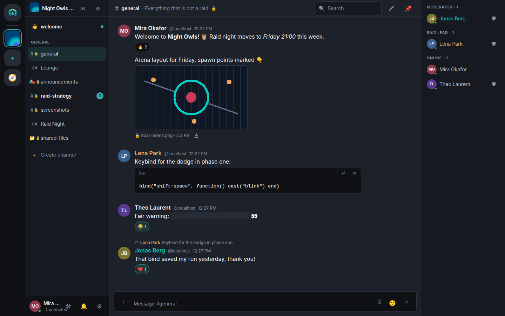
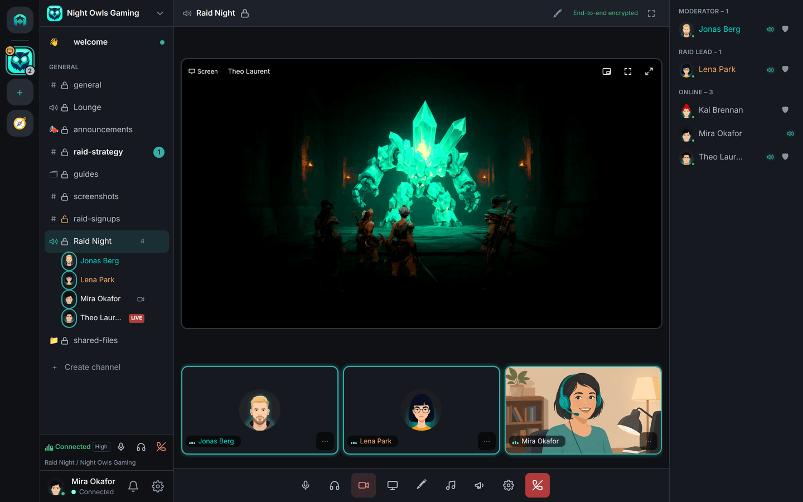
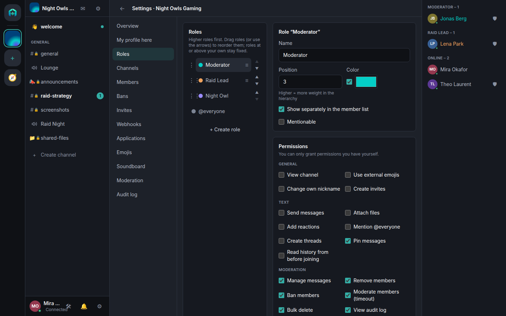
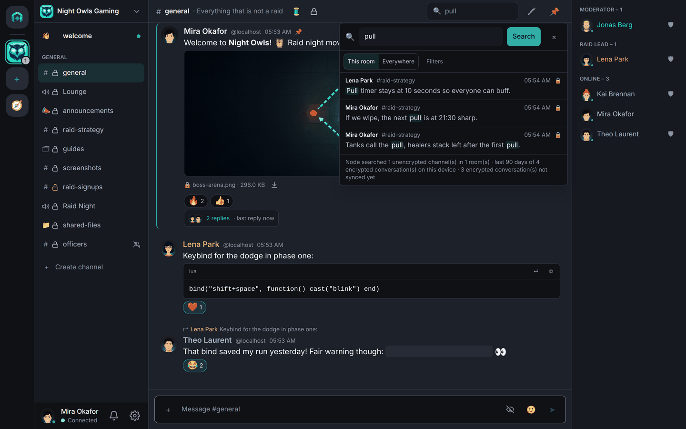
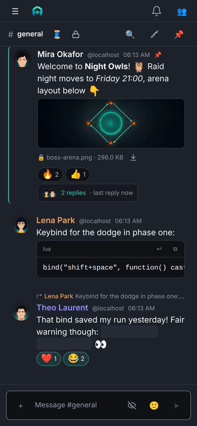
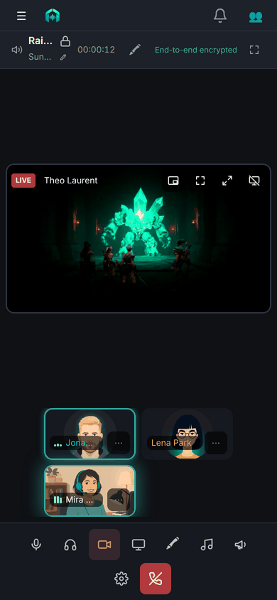

  <picture>
    <source media="(prefers-color-scheme: dark)" srcset="assets/logo-320.png">
    
  </picture>

<h1 align="center">tavrn</h1>

  <strong>Your community, your node, your keys.</strong> 
  A decentralized, open-source community chat with end-to-end encryption, voice and video, federation and
  self-hosting from a single container image.

  
  
  
  
  
  

  <a href="docs/architecture.md">Architecture</a> ·
  <a href="docs/roadmap.md">Roadmap</a> ·
  <a href="docs/self-hosting.md">Self-hosting</a> ·
  <a href="docs/faq.md">FAQ</a> ·
  <a href="docs/screenshots.md">Screenshots</a> ·
  <a href="https://github.com/just-tavrn/tavrn-protocol">Protocol</a> ·
  <a href="https://github.com/just-tavrn/tavrn/discussions">Discussions</a>

> **Status: in private review, going public soon.** The repositories of the
> [just-tavrn](https://github.com/just-tavrn) organization are being reviewed before the first public release.
> Some links may not work for you yet, and nothing is published to package registries so far.

## What tavrn is

tavrn is a chat for communities: rooms with text, voice, announcement, forum and files channels, roles and
permissions, screen sharing, direct messages and friends. Anyone can run a **node**. All nodes
together form one network: an account on one node (`alice@node.example`) can join rooms on every other node,
and nobody needs a central service to do so.

Conversations are **end-to-end encrypted** with [MLS](https://www.rfc-editor.org/rfc/rfc9420), so the people
running a node never read along, and voice and video are encrypted with keys from the same groups. A node is
**one container image** configured with environment variables, next to PostgreSQL and the reverse proxy you
already have.

- 🔐 **End-to-end encrypted by default.** Channels, DMs, group DMs, attachments, shared files and calls; plaintext channels exist
  only as an explicit choice of the room, with a permanent banner in every client.
- 🌐 **Federated without a centre.** Each room lives on exactly one node; clients talk to that node directly,
  nodes only exchange signed notifications. Use your own domain for your addresses.
- 🎙️ **Voice, video and screen sharing.** LiveKit is built into the image; media frames are encrypted with
  keys derived from MLS.
- 🤖 **Bots and integrations that respect encryption.** Bots are visible MLS members, rooms can declare "no
  bots" zones, and webhooks can post into encrypted channels without ever being able to read them.
- 🛡️ **Moderation for real communities.** Roles and overrides, audit log, bulk actions with preview,
  auto-moderation that works on metadata (so also in encrypted channels), reports, node and domain bans.
- 📦 **Self-hosting in one image.** One binary with the web client embedded, PostgreSQL, a reverse proxy for
  TLS, and a UDP range for voice. Optional Valkey when one node runs as several instances.
- ⚖️ **Operator tooling for the law.** Takedown notices, legal pages, terms acceptance, data export and
  account deletion, all optional.
- 💻 **A desktop app for Linux and Windows.** The same client in a Tauri shell, with global hotkeys for
  push-to-talk, the OS keychain for local keys, a tray icon, passkey unlock and a native voice engine on Linux;
  macOS and mobile apps follow.
- ♿ **Accessible.** The web client targets WCAG 2.2 AA and is checked automatically on phone, tablet and
  desktop layouts.

## Screenshots

<table>
  <tr>
    <td width="50%"></td>
    <td width="50%"></td>
  </tr>
  <tr>
    <td>A text channel: Markdown, code, replies, reactions, member list</td>
    <td>Voice and video, end-to-end encrypted</td>
  </tr>
  <tr>
    <td></td>
    <td></td>
  </tr>
  <tr>
    <td>Roles and permissions</td>
    <td>Search, also in encrypted channels (local index)</td>
  </tr>
</table>

  
  &nbsp;&nbsp;
  

More in [docs/screenshots.md](docs/screenshots.md). The screenshots show a local demo node with fictitious
accounts.

## Repositories

| Repository | What it is | License |
|---|---|---|
| [tavrn-protocol](https://github.com/just-tavrn/tavrn-protocol) | The protocol: specification, `openapi.json`, test vectors and permission tables; the contract every implementation follows | Apache-2.0 (schemas, vectors), CC-BY-4.0 (prose) |
| [tavrn-crypto](https://github.com/just-tavrn/tavrn-crypto) | The encryption core (Rust, OpenMLS), native and as WebAssembly (`@tavrn/crypto`) | MPL-2.0 |
| [tavrn-js](https://github.com/just-tavrn/tavrn-js) | JavaScript packages without UI: the SDK `@tavrn/sdk`, the encryption layer `@tavrn/e2ee` and the bot runtime `@tavrn/bot` | Apache-2.0 (`sdk`, `bot`), MPL-2.0 (`e2ee`) |
| [tavrn-node](https://github.com/just-tavrn/tavrn-node) | The node server (Rust), its container image, deployment examples and the operator documentation | AGPL-3.0-only |
| [tavrn-web](https://github.com/just-tavrn/tavrn-web) | The web client (React, TypeScript), the desktop app for Linux and Windows (Tauri), later the mobile apps, and the end-to-end test suite | Apache-2.0 |
| [.github](https://github.com/just-tavrn/.github) | Organization profile, contributing guide, code of conduct, security policy, CLA and shared CI workflows | CC-BY-4.0 (texts), Apache-2.0 (workflows) |
| **tavrn** (this repository) | The entry point: overview, architecture, roadmap, self-hosting orientation, FAQ, Discussions | CC-BY-4.0 (texts) |

## I want to…

| … | Start here |
|---|---|
| **understand how tavrn works** | [docs/architecture.md](docs/architecture.md), then the [protocol](https://github.com/just-tavrn/tavrn-protocol) |
| **run a node** | [docs/self-hosting.md](docs/self-hosting.md) for the overview, then the [operator handbook](https://github.com/just-tavrn/tavrn-node/blob/main/docs/HANDBOOK.md) in [tavrn-node](https://github.com/just-tavrn/tavrn-node) |
| **build a client or a bot** | the [protocol](https://github.com/just-tavrn/tavrn-protocol) (start with `PROTOCOL.md` and `APPLICATIONS.md`) and the packages in [tavrn-js](https://github.com/just-tavrn/tavrn-js) (`@tavrn/sdk`, `@tavrn/bot`) |
| **contribute code, docs or translations** | the organization's [contributing guide](https://github.com/just-tavrn/.github/blob/main/CONTRIBUTING.md) and [code of conduct](https://github.com/just-tavrn/.github/blob/main/CODE_OF_CONDUCT.md) |
| **report a vulnerability** | privately, as the [security policy](https://github.com/just-tavrn/.github/blob/main/SECURITY.md) describes; never in a public issue |
| **ask a question or share an idea** | [Discussions](https://github.com/just-tavrn/tavrn/discussions) |
| **see what comes next** | [docs/roadmap.md](docs/roadmap.md) |

Bugs and feature requests belong in the repository that owns the code; the issue chooser of this repository
links each of them.

## License and trademark

The texts in this repository are licensed under [CC-BY-4.0](LICENSE); the scripts and workflows under
Apache-2.0. Details, including the attribution we ask for, are in [LICENSE.md](LICENSE.md). Each code
repository carries its own license (table above).

The name "tavrn" and the logo and icons (the files in [`assets/`](assets)) are **not** covered by these
licenses. Running your own node with the name and logo is fine; distributed forks and hosting businesses
under the name need permission. See [TRADEMARK.md](TRADEMARK.md).
