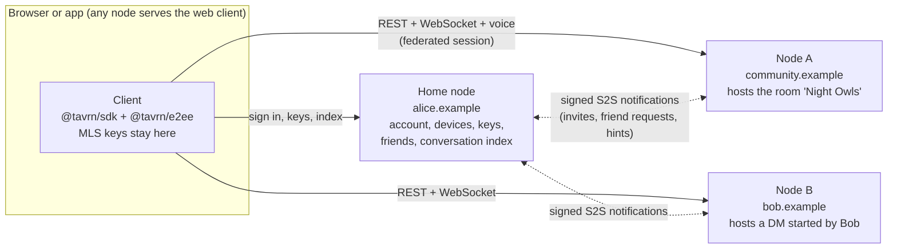
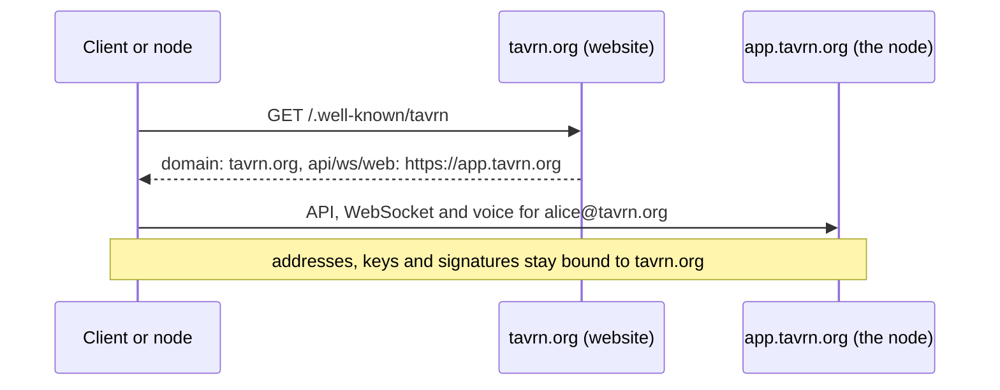
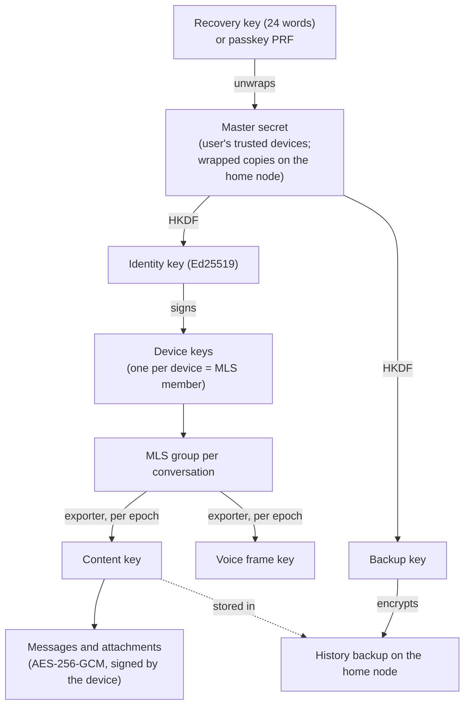

# Architecture

tavrn in one page, with pointers into the protocol for everything normative. The
[protocol repository](https://github.com/just-tavrn/tavrn-protocol) is the authoritative source; where this
overview and the protocol disagree, the protocol wins (and this page has a bug, please report it).

## The system in one page

A **node** is one tavrn installation under one domain, run by a person, a club, a company or a hosting
provider. It hosts **accounts** and **rooms** (communities with categories, channels and roles). All nodes
together form one network; there is no central server, no central directory and no central web client.

The guiding rules:

1. **A room lives on exactly one node.** Rooms are not replicated between nodes and there is no conflict
   resolution of shared state. The price is plain: if a node is offline, its rooms are offline, as with any
   centrally hosted community.
2. **Clients talk directly to the node that hosts a conversation.** The home node is responsible only for
   the account, devices and keys, friends, settings and the index of "where are my conversations".
3. **Everything is a conversation.** Channels, DMs and group DMs share the same message format, encryption and
   realtime machinery; only membership and permissions differ.
4. **The client uses only the public API.** Whatever the reference client can do, a bot or a third-party
   client can do.
5. **Proven building blocks** instead of home-grown ones: MLS (RFC 9420) for group encryption, LiveKit for
   media, PostgreSQL for storage. No home-grown cryptographic primitives, no home-grown WebRTC.
6. **One binary, one image, one domain**, configured through environment variables.
7. **Compatibility from day one**: capability lists instead of version comparisons, unknown fields and event
   types are ignored, breaking changes only under a new API version.

Two languages carry the project: **Rust** for the node and the encryption core, **TypeScript** for the web
client, the SDK and the bot runtime. The encryption core is one Rust crate used natively by the node and,
compiled to WebAssembly, by browsers and bots.

## Nodes and identities

| Term | Meaning |
|---|---|
| Node | One tavrn instance, identified by its domain (`node.example`) |
| Home node | The node where an account exists and signs in |
| Room | A community with categories, channels and roles; lives on one node (elsewhere often called a "server") |
| Channel | Text, voice, announcement, forum or files |
| Conversation | A channel, a DM or a group DM |
| Application | A bot or integration, owned by a user account |

- **Addresses** look like e-mail: `alice@node.example`. The username is immutable and unique on the home node;
  display names are free text. Rooms, channels and messages have node-local ULIDs that are globally unique
  together with the node's domain.
- **One account, several devices.** Every device has its own key pair and is its own member of every encrypted
  group it takes part in. Devices are signed by the user's identity key, which the user, not the node, holds.
- **Signing in elsewhere.** To use a room on node A, the client asks its home node for a short-lived
  **federation token** for A (signed by the home node, bound to A), and A turns it into a local session. A
  never sees a password or a second factor.
- **Server-to-server traffic is notifications only**: friend requests, room invites, "a new DM for you on node
  X", push hints, key change hints. Every message is signed by the sending node and delivered through an
  inbox with retries. Messages themselves never travel between nodes; the client fetches them from the
  conversation's node.
- **DMs and group DMs** live on the home node of the person who starts them; the others join with a federated
  session there.
- **Accounts are protected by a mandatory second factor** (TOTP or passkeys) for every password account.
  Operators can attach single sign-on (OpenID Connect) instead.
- **Ages stay at home.** Registration asks for a date of birth (the user's own statement) and the node's minimum
  age applies. The date never leaves the home node; for adults-only rooms and channels on other nodes the home node
  signs only an "18 or older" claim into the federation token.
- **Permissions are layered.** Room roles grant permission bits, categories and channels refine them with
  overrides for roles and single members, and a member who cannot view a channel receives nothing about it: no
  events, notification hints or pushes, and room details leave it out.

Specification: [`PROTOCOL.md`](https://github.com/just-tavrn/tavrn-protocol/blob/main/PROTOCOL.md) §1, §5,
§5a; [`FEDERATION.md`](https://github.com/just-tavrn/tavrn-protocol/blob/main/FEDERATION.md) §2–§6.

## Discovery

Every node publishes `https://<domain>/.well-known/tavrn`: its name, the API, WebSocket and web URLs, its
public signing keys (rotatable, with key ids), the protocol version, its capabilities, the registration mode
and public policies such as upload and voice limits. Clients and other nodes resolve every domain through this
document first and cache it.

**Delegation** separates the identity domain from the host that runs the node, like e-mail's MX records:

The identity domain serves the document (a static copy or a reverse-proxy rule) or, alternatively, a DNS
record `_tavrn._tcp.<domain>`. Moving the node to another host then changes nothing for its users' addresses.

The **node directory** works without a central instance: each node knows one or more reference nodes, announces
itself with signed messages and learns peers from their lists. The "Discover" page shows public rooms of the
whole network, each listing signed by the node that hosts the room. Operators can opt out of listing.

Specification: [`PROTOCOL.md`](https://github.com/just-tavrn/tavrn-protocol/blob/main/PROTOCOL.md) §2–§3,
[`FEDERATION.md`](https://github.com/just-tavrn/tavrn-protocol/blob/main/FEDERATION.md) §1 and §7.

## End-to-end encryption

- **One MLS group per conversation.** Every channel, DM and group DM is an MLS group (RFC 9420, via OpenMLS);
  the members are devices. The node acts as the delivery service: it orders commits and stores the group info,
  and it checks who may commit, but it holds nothing that lets it read.
- **Per-epoch content keys.** Each MLS epoch exports a content key; messages and attachment keys are encrypted
  with it and signed by the sending device. This keeps forward secrecy per epoch and post-compromise security
  through MLS while allowing history: a new device restores the **history backup** (content keys encrypted with
  the backup key, stored on the home node), and channels can share keys of older epochs with new members within
  the room's history policy (`since_join`, `days:<n>` or `all`). Such shares are sealed to each recipient device
  under a share key that the device key attests, so the node only routes them.
- **History after a key reset.** A reset does not hand the old history to the new keys automatically (whoever
  took over an account would read it). The member asks the room for it; another member with the permission to
  restore history approves or denies, the approval is recorded in the audit log and the welcome channel, and only
  then do the other members' clients share the older keys, within the same policy.
- **Recovery without passwords as keys.** The master secret is wrapped for the home node under a recovery key
  (shown once as 24 words) and optionally a passkey's PRF output. Passwords never derive encryption keys, so a
  leaked password database gives nothing to brute-force.
- **Identity continuity.** Contacts pin each other's identity keys, can compare safety numbers or scan a QR
  code, and see a "security key changed" notice. A user can rotate the identity key with a signed continuity
  statement and keep the history; losing every way to the master secret means an **identity reset**: old
  encrypted history is gone, everything else keeps working.
- **What the node sees.** It never sees message content, attachment content, file names in encrypted
  conversations, backups or the master secret. It does see metadata: who is in which conversation, who writes
  when, the mention list (so it can notify), sizes and timing. A malicious node can deny service and could try
  to add a "ghost" device of one of its own users; clients detect and warn about members that are not signed by
  their user's identity key.
- **Plaintext only as an explicit choice.** DMs, group DMs and voice are always encrypted. A room admin may
  switch an individual text, announcement or forum channel to plaintext (for server-side search, very large
  public channels or integrations); every client must then show a permanent banner above the messages ("This
  channel is not end-to-end encrypted. The operator of node.example can read along.").
- **Files channels** (shared folder trees) are end-to-end encrypted by default, with their own MLS group like a
  text channel. Every file gets a random file key; content and thumbnail are encrypted in 1 MiB AES-256-GCM chunks
  under part keys derived from it with HKDF, and the name, type and file key travel in an entry record encrypted
  under the channel's group. The node stores ciphertext and sees sizes, times, the folder structure and who
  uploaded, never names or contents; search runs on the clients' local index. New members get the earlier files
  by default (history policy `all`, or `since_join`), and members who lost their keys can still delete their own
  uploads. Whether a files channel is encrypted is chosen when it is created and cannot change; an unencrypted
  one shows a permanent banner.
- **Search** in encrypted conversations uses a local, encrypted index on the device; nodes only search
  plaintext channels.

The honest limit of every browser-based end-to-end encryption applies: the web client is code served by a
node, so a malicious node could serve a modified client. The desktop app, which bundles the client it was
installed with, and reproducible builds narrow this.

Specification: [`ENCRYPTION.md`](https://github.com/just-tavrn/tavrn-protocol/blob/main/ENCRYPTION.md)
(threat model in §11), [`SEARCH.md`](https://github.com/just-tavrn/tavrn-protocol/blob/main/SEARCH.md),
[`PROTOCOL.md`](https://github.com/just-tavrn/tavrn-protocol/blob/main/PROTOCOL.md) §8 (the banner),
[`FILES.md`](https://github.com/just-tavrn/tavrn-protocol/blob/main/FILES.md) §8 (encrypted files channels);
history shares and restores in `ENCRYPTION.md` §7b.
Implementation: [tavrn-crypto](https://github.com/just-tavrn/tavrn-crypto) and `@tavrn/e2ee` in
[tavrn-js](https://github.com/just-tavrn/tavrn-js).

## Voice, video and screen sharing

- **LiveKit is part of the image.** The node starts and supervises `livekit-server` as a child process, issues
  every LiveKit token (with exactly the sources a member may publish: microphone, camera, screen) and proxies
  the signaling under its own domain after checking the token. Only the media ports bypass the reverse proxy.
- **End-to-end encrypted media.** A voice channel is a conversation with its own MLS group. Each epoch exports a
  frame key that the client hands to LiveKit's encryption (insertable streams); the node and LiveKit forward
  only encrypted frames. A client never publishes before encryption is confirmed. Consequence: no server-side
  recordings, and a bot that wants to hear must be a member.
- **Connectivity.** Media uses a UDP port range; ICE over TCP and an embedded TURN server (over UDP, or over TLS
  through the reverse proxy on port 443) cover strict networks. The client has a connection test that tries
  every path and says what to fix.
- **Native voice in the desktop app.** On Linux (and on Windows as an experimental setting) the desktop app joins
  calls with LiveKit's Rust SDK instead of the webview's WebRTC, through the same signaling proxy and with the same
  frame keys, so it talks to browsers without any difference for the node.
- **Moving members.** A member with the permission to move others can move a member into a voice channel that member
  could not join or even see on their own; the move grants exactly that participation and ends with it.
- Calls in DMs and group DMs, webcams with a tile view, screen sharing within node limits, a soundboard, a shared
  whiteboard and graceful reconnects use the same machinery.

Specification: [`VOICE.md`](https://github.com/just-tavrn/tavrn-protocol/blob/main/VOICE.md),
[`ENCRYPTION.md`](https://github.com/just-tavrn/tavrn-protocol/blob/main/ENCRYPTION.md) §5a,
[`WHITEBOARD.md`](https://github.com/just-tavrn/tavrn-protocol/blob/main/WHITEBOARD.md).

## Applications, bots and webhooks

- **A bot is an account with an owner.** An application gets its own address (`weatherbot@node.example`), a
  BOT badge in every client, and tokens instead of a password, optionally restricted by scopes. Banning the
  owner bans all their bots.
- **Bots join encrypted conversations as MLS members**, with their own key file and devices, so they read and
  write only where they are visible members. Members see in the channel's security log when a bot joins or
  leaves an encrypted channel.
- **"No bots" zones.** Room admins can close a room, a category or a channel to bots; by default new rooms keep
  encrypted channels closed to bots unless a channel explicitly allows them. Clients treat a bot device in such
  a channel as a ghost member.
- **Adding a bot** happens through its add link and a consent screen that shows the permissions it asks for; a
  bot never gets more than the person adding it holds.
- **Commands** (`/weather berlin`) appear in the client's palette; arguments are encrypted in encrypted
  conversations.
- **Webhooks** post into channels by URL. Into encrypted channels they post **sealed, write-only**: the members
  derive an inbox key pair per epoch, the sender (or, if the creator chooses so explicitly, the node at the
  moment of receipt) seals the message to the public key, and nobody but the members can read it, not even the
  webhook. Outgoing event subscriptions and single sign-on through OpenID Connect complete the integration
  surface.

Specification: [`APPLICATIONS.md`](https://github.com/just-tavrn/tavrn-protocol/blob/main/APPLICATIONS.md),
[`ENCRYPTION.md`](https://github.com/just-tavrn/tavrn-protocol/blob/main/ENCRYPTION.md) §5b. SDK and bot
runtime: [tavrn-js](https://github.com/just-tavrn/tavrn-js).

## The federation trust model

Trust lives in the client and in cryptography, never in a node. The code of another node cannot be verified
remotely, and modified nodes are explicitly welcome as long as they follow the protocol, so tavrn checks
behaviour instead of code:

- **Client-enforced cryptography.** A node cannot read content, impersonate users (devices are signed by the
  user's identity key), add unsigned devices unnoticed, or switch encryption off (clients only send ciphertext
  where encryption is on). Federation tokens are signed by the home node and bound to the target and a short
  lifetime.
- **Conformance checks.** Nodes regularly test their peers: a valid discovery document and TLS, rejection of a
  deliberately manipulated token, rejection of plaintext in encrypted conversations, rate limits. Hard
  cryptographic failures block the peer automatically; clients show when a node does not pass.
- **Reputation and blocklists.** Users report nodes and rooms to their home node's admins; operators keep their
  own blocklists, can subscribe to lists maintained by communities, and ban whole domains from rooms or the
  node. Spam patterns from one node lead to throttling and, on repetition, to a block.
- **Defensive networking.** Every outgoing request to a peer uses verified TLS, refuses private address ranges
  and caps size and time.

Specification: [`FEDERATION.md`](https://github.com/just-tavrn/tavrn-protocol/blob/main/FEDERATION.md) §9–§11.

## Scaling

A node is one process with PostgreSQL by default, and that is enough for most communities: realtime events,
presence and rate limits live in memory. For more capacity or availability an operator can run **several
instances of the same node** behind a load balancer; they share the database, the data volume and an optional
**Valkey** (or Redis) that carries the event bus, presence, shared rate limits and a leader for singleton jobs
and voice state. Without Valkey configured, nothing changes. Details are in the operator documentation of
[tavrn-node](https://github.com/just-tavrn/tavrn-node).

## Legal and privacy features

Operators are responsible for their node; tavrn gives them the tools, all optional and invisible when unused:

- **Takedown notices** (DMCA and EU DSA style): a public form, cases with states, a statement of reasons to the
  uploader, counter-notices and forwarding to the content's node. Encrypted content is never decrypted for this;
  the admin sees only metadata and can still remove it.
- **Legal pages**: imprint, privacy policy and terms, written in the admin settings, reachable within two clicks
  from every screen, with versioned terms acceptance. Templates are provided and marked as not legal advice.
- **Data rights**: users export what the node holds about them and delete their account themselves, optionally
  with their messages; other nodes are notified.

Specification: [`LEGAL.md`](https://github.com/just-tavrn/tavrn-protocol/blob/main/LEGAL.md).

## Accessibility

The web client targets **WCAG 2.2 level AA**: keyboard access and visible focus everywhere, labelled dialogs
with focus traps, a message feed announced to screen readers (mutable), sufficient contrast, reduced motion and
target sizes. Automated axe-core checks run against the main screens on phone, tablet and desktop layouts and
fail on serious violations; known gaps and an accessibility statement template for operators are documented in
[tavrn-web](https://github.com/just-tavrn/tavrn-web). Accessibility regressions are bugs; please report them.
