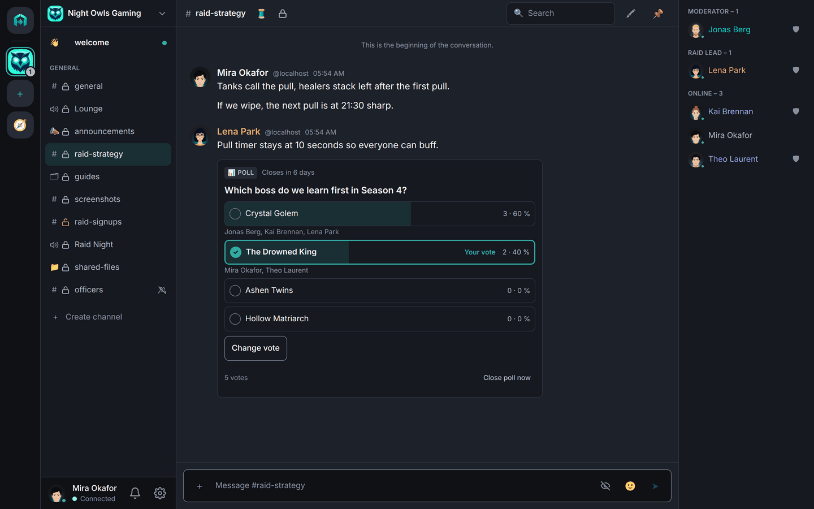
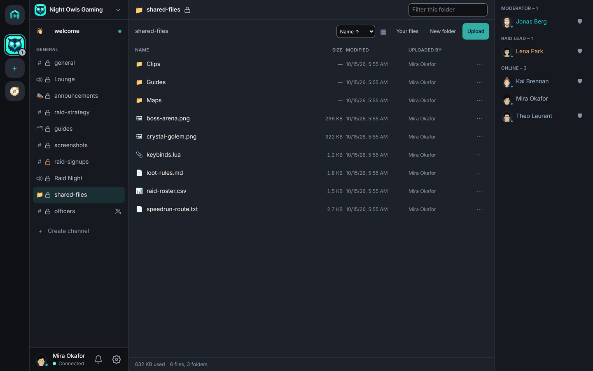
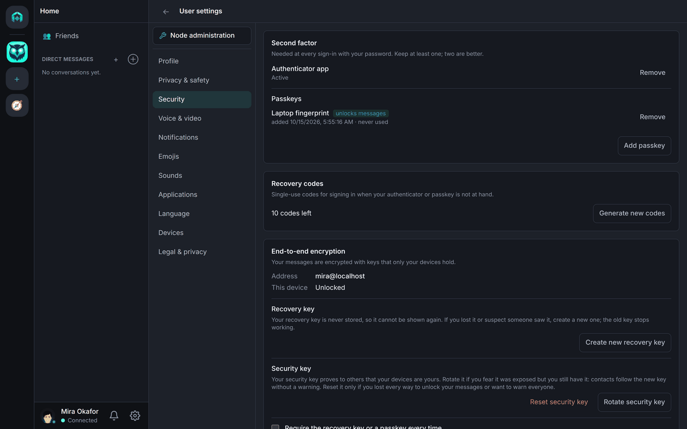
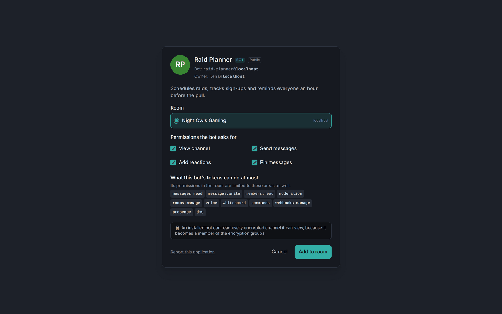
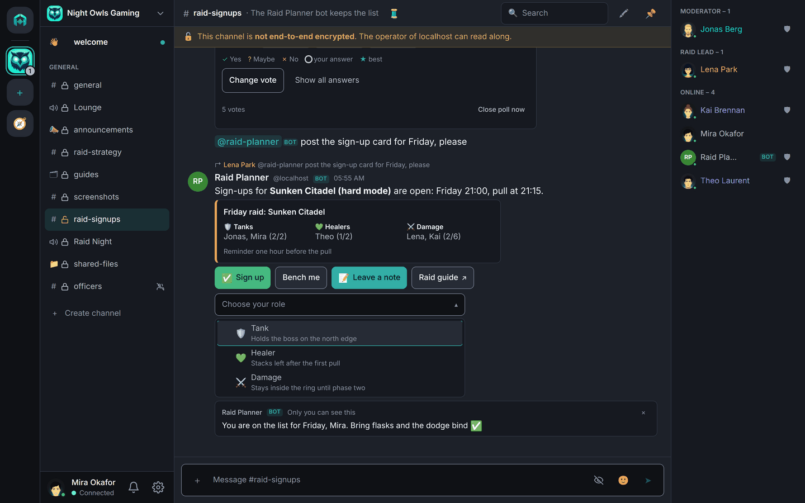
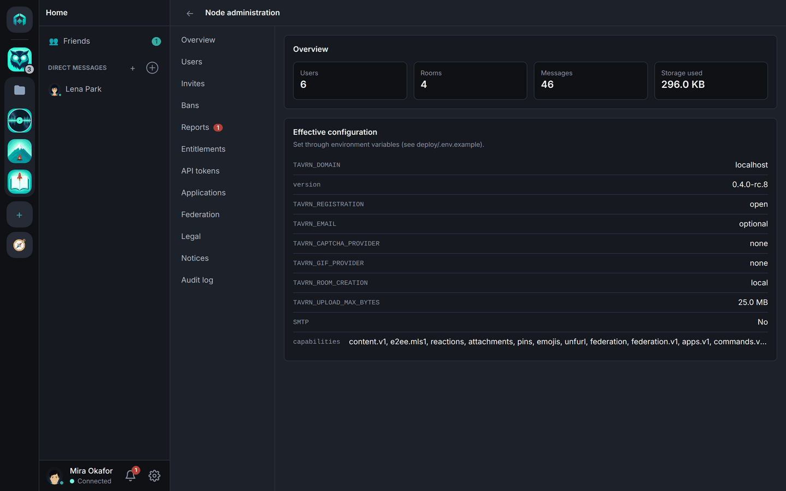

# Screenshots

The web client on a local demo node: a fictitious room "Night Owls Gaming" with five demo accounts, dark theme,
English locale. The pictures come from the website's screenshot pipeline ([tavrn.org](https://tavrn.org)); desktop
screenshots are 1440×900, phone screenshots 390×844. How they are made:
[assets/screenshots/README.md](../assets/screenshots/README.md).

## Chat

An end-to-end encrypted text channel: Markdown, a pinned message with an image and a thread, a code block, a
spoiler, a reply and reactions; the member list grouped by roles on the right.

## Voice and video

A voice channel with four participants, a shared screen and a camera, end-to-end encrypted with keys from the
channel's MLS group ("End-to-end encrypted" in the header). The channel list shows who is in which voice channel.

## Polls

A poll in an encrypted channel after voting: result bars with counts, shares and voters, your own vote marked, and
**Change vote**. Date polls show their results as a compact grid of days and times. Votes in encrypted channels are
encrypted too.

## Search

Search in encrypted channels runs on a local, encrypted index on the device; the status line says honestly what
was searched.

## Roles and permissions

The role editor of the room settings: hierarchy, colour, "show separately" and the permission switches.

## Files channel

A shared folder tree per channel, with uploads, previews and a storage meter. Files channels are end-to-end
encrypted by default: names, folder names and contents are encrypted on the devices, and search runs on the local
index. A channel created without encryption gets a permanent banner saying so.

## Security settings

The mandatory second factor (authenticator app, passkeys), recovery codes, the recovery key and the security key.

## Adding a bot

The consent screen of an application's add link: who owns the bot, the permissions it asks for, the upper bound
of its tokens, and a plain notice that a bot reads the encrypted channels it can view.

## Buttons and forms of bots

Bots can add buttons, select menus and forms to their messages; the client draws them with its own controls. An
answer can be visible to the person who clicked alone ("Only you can see this").

## Node administration

The overview of the node admin page with the effective configuration.

