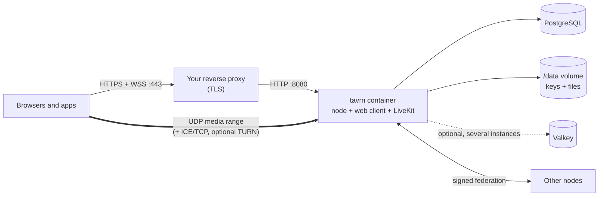

# Self-hosting: an orientation

This page tells you what running a tavrn node involves, so you can decide whether it fits your server and your
community. The actual installation guide, every configuration variable and the reverse proxy examples live in
the [operator handbook](https://github.com/just-tavrn/tavrn-node/blob/main/docs/HANDBOOK.md) of [tavrn-node](https://github.com/just-tavrn/tavrn-node); this page only points
there.

> tavrn is in private review. The container image is not published yet; until then a node is built from the
> tavrn-node repository.

## What a node is

One container image (`ghcr.io/just-tavrn/tavrn-node` once published) holds everything that belongs to a node:

- the node server (`tavrn-node`, one Rust binary) with the HTTP API and the WebSocket,
- the web client, embedded in the binary and served at `/`, so every node is also a place to sign in,
- `livekit-server` for voice, video and screen sharing, started and supervised by the node,
- the blob storage for attachments, avatars and emojis on a data volume (encrypted at rest with per-file keys).

Everything is configured through `TAVRN_*` environment variables (optionally a configuration file); the
handbook's [Configuration](https://github.com/just-tavrn/tavrn-node/blob/main/docs/HANDBOOK.md#configuration) section lists every variable with its default. The node validates its
configuration at start and refuses to start with a precise list of problems.

## What you need

| Requirement | Why |
|---|---|
| **A domain** | It becomes the identity of your node and part of every address (`alice@chat.example.org`). Choose it with care: addresses cannot be renamed. You can serve the node on another host than the identity domain (delegation through `/.well-known/tavrn` or a DNS record), so `example.org` can be the identity while the node runs on `chat.example.org`. |
| **A reverse proxy with TLS** | The node speaks plain HTTP only and does no certificate management on purpose. nginx, Caddy, Traefik or Nginx Proxy Manager terminate TLS and forward to the container, with WebSocket support. tavrn-node ships examples for nginx and Caddy. |
| **PostgreSQL** | The production database: the one in the provided compose file or any existing PostgreSQL server or managed service. (SQLite exists only for development.) |
| **The image and a data volume** | The volume holds the node's signing keys, the key that encrypts data at rest, the storage key of the file encryption and the uploaded files. **Back it up together with the database**; without the key files the stored data is unreadable. |
| **A UDP port range for voice** | Media bypasses the proxy: a UDP range (default `61000-61100`, about 50 participants node-wide) plus ICE over TCP on one port, published to the container, open in the firewall and forwarded by the router. Voice can also be switched off completely. |
| **Optionally TURN** | For users behind very strict networks: the embedded TURN server over UDP, or over TLS on port 443 through your reverse proxy. |
| **Optionally SMTP** | For e-mail confirmation, password resets and legal notices. Without it the node works without e-mail. |
| **Optionally Valkey** | Only to run one node as several instances behind a load balancer. A single instance needs nothing besides PostgreSQL. |

Hardware needs are modest: the node is a single Rust process, and the server never processes message content
(it is encrypted). Voice traffic is the part that grows with use. Details: [Requirements](https://github.com/just-tavrn/tavrn-node/blob/main/docs/HANDBOOK.md#requirements),
[Reverse proxy and TLS](https://github.com/just-tavrn/tavrn-node/blob/main/docs/HANDBOOK.md#reverse-proxy-and-tls), [Voice and video](https://github.com/just-tavrn/tavrn-node/blob/main/docs/HANDBOOK.md#voice-and-video) and
[Scaling with Valkey](https://github.com/just-tavrn/tavrn-node/blob/main/docs/HANDBOOK.md#scaling-with-valkey) in the handbook.

## The decisions you make as an operator

- **Who may register**: open, by invite (the default) or closed; whether e-mail is required; an optional
  captcha; the minimum age (16 by default; every registration states a date of birth, which stays private). The
  first account becomes node admin.
- **Who may create rooms**, and the limits per user and room: upload size and types, storage quotas, message
  retention, voice bitrate, screen sharing and camera limits.
- **Federation**: on by default; blocklists of other nodes, domain bans, whether your node is listed in the
  directory, and which reference nodes it announces itself to.
- **Applications**: who may create bots, whether commands need approval, whether bots from other nodes are
  allowed.
- **Single sign-on** through OpenID Connect (Authentik, Keycloak and others), with groups mapped to node and room
  roles, if your community already has a login.
- **Legal setup**: imprint, privacy policy and terms (templates are included, marked as not legal advice), the
  takedown notice form and its contact. Depending on where you are and whom you serve, some of this may be
  required by law; tavrn gives you the tools, the responsibility stays with you.

Every user's second factor is mandatory and cannot be switched off by the operator. You can never read the
content of encrypted conversations; you do see metadata and plaintext channels. Be honest about that in your
privacy policy (the template is).

## Updates and backups

Database migrations run automatically at start and only forward; the node refuses to start when the database is
newer than the binary. Back up the database (`pg_dump`) and the data volume before every update. Follow the
releases of tavrn-node for security fixes. The handbook describes [keys and backups](https://github.com/just-tavrn/tavrn-node/blob/main/docs/HANDBOOK.md#keys-and-backups),
[upgrade and rollback](https://github.com/just-tavrn/tavrn-node/blob/main/docs/HANDBOOK.md#upgrade-and-rollback), [metrics and health](https://github.com/just-tavrn/tavrn-node/blob/main/docs/HANDBOOK.md#metrics-and-health) and a
[security hardening checklist](https://github.com/just-tavrn/tavrn-node/blob/main/docs/HANDBOOK.md#security-hardening-checklist).

## Where to go next

1. The [operator handbook](https://github.com/just-tavrn/tavrn-node/blob/main/docs/HANDBOOK.md) of tavrn-node, one document from top to bottom:
   [installation with Docker Compose](https://github.com/just-tavrn/tavrn-node/blob/main/docs/HANDBOOK.md#install-with-docker-compose), every variable
   ([Configuration](https://github.com/just-tavrn/tavrn-node/blob/main/docs/HANDBOOK.md#configuration)), the [reverse proxy](https://github.com/just-tavrn/tavrn-node/blob/main/docs/HANDBOOK.md#reverse-proxy-and-tls) (including TURN over TLS and
   [delegation](https://github.com/just-tavrn/tavrn-node/blob/main/docs/HANDBOOK.md#identity-domain-and-node-host-delegation)), [voice connectivity](https://github.com/just-tavrn/tavrn-node/blob/main/docs/HANDBOOK.md#voice-and-video),
   [web push](https://github.com/just-tavrn/tavrn-node/blob/main/docs/HANDBOOK.md#web-push), [scaling with Valkey](https://github.com/just-tavrn/tavrn-node/blob/main/docs/HANDBOOK.md#scaling-with-valkey), [backups](https://github.com/just-tavrn/tavrn-node/blob/main/docs/HANDBOOK.md#keys-and-backups) and
   [storage key rotation](https://github.com/just-tavrn/tavrn-node/blob/main/docs/HANDBOOK.md#rotating-the-storage-key), [troubleshooting](https://github.com/just-tavrn/tavrn-node/blob/main/docs/HANDBOOK.md#logs-and-troubleshooting).
2. The [architecture overview](architecture.md), to understand what your node does and what it cannot do.
3. [Discussions](https://github.com/just-tavrn/tavrn/discussions), category "Q&A", when you get stuck.

Running your node under the name "tavrn" with the unmodified logo is fine; see [TRADEMARK.md](../TRADEMARK.md)
for distributed forks and hosting businesses.
